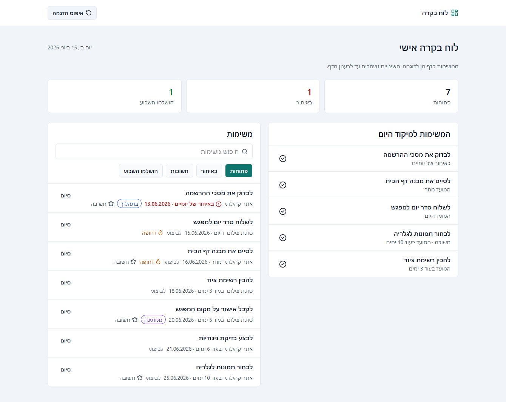

# My Dashboard

My Dashboard is a Hebrew, right-to-left workspace for managing personal tasks and projects. The full application includes a daily task view, calendar, templates, and a planning timeline. It uses Next.js, TypeScript, and Supabase.



## Try the demo

With Node.js 20.9 or later, run these commands from the repository root.

```sh
npm ci
npm run dev
```

Open the [local demo](http://localhost:3000/demo). The Today panel explains its task recommendations. Search by title, switch filters, complete or reopen a task, and use **איפוס הדגמה** to reset the sample data. Changes last until you reload the page. The demo runs without an account, credentials, or a database. When Supabase is unconfigured, the home page opens the demo automatically.

## Run the full application locally

Start Docker, then start the local Supabase stack from the repository root.

```sh
npx supabase start
```

Create `.env.local` and copy the API URL and publishable (or `anon`) key from the local Supabase output.

```dotenv
NEXT_PUBLIC_SUPABASE_URL=http://127.0.0.1:54321
NEXT_PUBLIC_SUPABASE_PUBLISHABLE_KEY=replace-with-the-local-key
```

In local Supabase Studio, create a user under **Authentication → Users**. Run `npm run dev`, open the home page, and sign in with that user. Create sample tasks and projects through the interface.

## Architecture

- `src/domain/` contains framework-independent scheduling, urgency, task filtering, and prioritization rules. The signed-in app and demo use the same rules.
- `src/app/` and `src/components/` contain the RTL interface. `src/server/` handles authenticated reads and mutations.
- `supabase/migrations/` defines the Postgres schema, row-level security, and ownership constraints.

## Development checks

```sh
npm run lint
npm run typecheck
npm test
npm run build
```

Playwright covers authenticated workflows. Run `npm run test:e2e` against a disposable Supabase instance with a dedicated test user and `E2E_EMAIL` and `E2E_PASSWORD` configured. The tests create and remove database records.

See [third-party notices](THIRD_PARTY_NOTICES.md) for the license of generated and adapted UI components.
